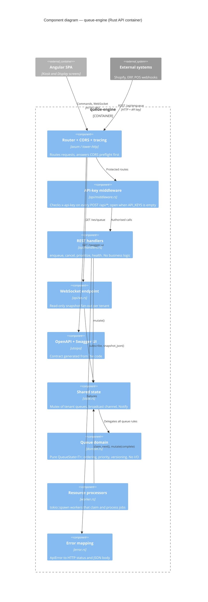
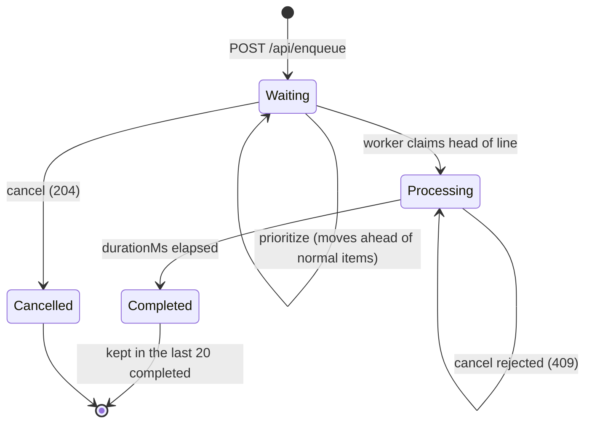
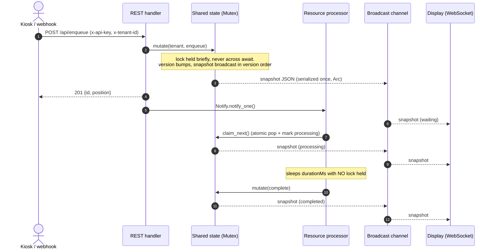
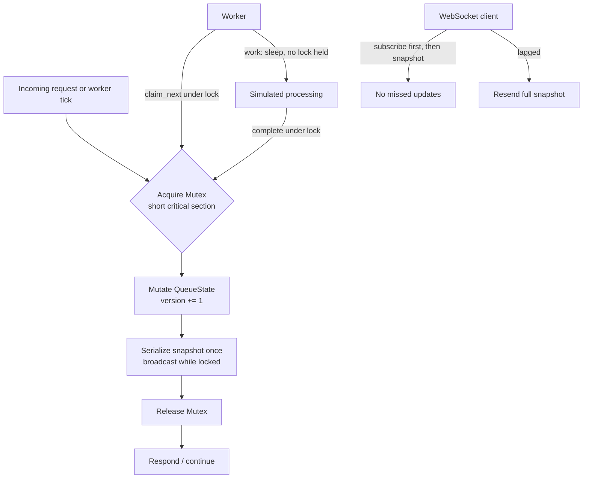

# Queue Engine — Rust backend

A multi-tenant, real-time queue and resource-allocation engine built on **Tokio + Axum**. The same core serves very different businesses (boutique check-ins, distributor order fulfilment, factory job processing): the engine is generic over the item payload and knows nothing about what a job *is*.

- **REST ingestion** — `POST /api/enqueue` etc., usable by the kiosk UI *and* by headless systems (Shopify webhooks, ERPs, POS) with an API key.
- **Live state over WebSocket** — `/ws/queue` pushes a full snapshot after every change.
- **Background resource processors** — `tokio::spawn`ed workers claim and process jobs asynchronously.
- **OpenAPI + Swagger UI** — generated from the code.

The Angular UI lives in [`../Frontend`](../Frontend/README.md).

## Quick start

Prerequisites: Rust (stable). On Windows you also need the **MSVC C++ Build Tools** (`winget install Microsoft.VisualStudio.2022.BuildTools --override "--quiet --wait --add Microsoft.VisualStudio.Workload.VCTools --includeRecommended"`), otherwise linking fails.

```bash
API_KEYS=kiosk-key-123 cargo run          # PowerShell: $env:API_KEYS="kiosk-key-123"; cargo run
```

| URL | Purpose |
|---|---|
| `http://localhost:3000/health` | Liveness probe |
| `http://localhost:3000/swagger-ui` | Interactive API docs |
| `http://localhost:3000/api-docs/openapi.json` | OpenAPI spec |
| `ws://localhost:3000/ws/queue?tenant=default` | Live snapshots |

### Configuration (environment variables)

| Variable | Default | Meaning |
|---|---|---|
| `API_KEYS` | *(empty)* | Comma-separated accepted `x-api-key` values. **Empty = open dev mode** (a warning is logged). |
| `BIND_ADDR` | `0.0.0.0:3000` | Listen address. |
| `RUST_LOG` | `info,tower_http=debug` | Log filter. |

The number of resource workers (`2`) is `RESOURCE_WORKERS` in `src/config.rs`.

## API

Full contract: Swagger UI, or the UI-oriented summary in [`../Frontend/API_CONTEXT.md`](../Frontend/API_CONTEXT.md).

| Method & path | Auth | Description |
|---|---|---|
| `POST /api/enqueue` | key | Add an item. Body: `{ "label": "Order #1", "priority": "normal\|high", "payload": { "durationMs": 5000 } }` → `201 { id, position }` |
| `POST /api/items/{id}/cancel` | key | Remove a *waiting* item → `204`; `404` unknown; `409` already processing |
| `POST /api/items/{id}/prioritize` | key | Promote a waiting item → `200 { id, position }` |
| `GET /ws/queue?tenant=` | none | WebSocket, read-only; sends a snapshot on connect and after each change |
| `GET /health` | none | `ok` |

Headers: `x-api-key` (required when `API_KEYS` is set → otherwise `401`), `x-tenant-id` (optional, default `default`, `[A-Za-z0-9_-]` up to 64 chars → otherwise `400`). Errors are always `{ "error": "<message>" }`.

### Headless example

```bash
curl -X POST http://localhost:3000/api/enqueue \
  -H 'content-type: application/json' -H 'x-api-key: kiosk-key-123' -H 'x-tenant-id: acme' \
  -d '{"label":"Shopify #9001","payload":{"durationMs":3000}}'
```

Open `http://localhost:4200/display?tenant=acme` and the order appears with no UI interaction.

### Snapshot shape (WebSocket)

```jsonc
{ "tenant": "acme", "version": 12,   // monotonic per tenant
  "waiting":    [{ "status": "waiting",    "id": "…", "label": "…", "priority": "normal", "payload": {}, "enqueuedAt": "…" }],
  "processing": [{ "status": "processing", "…": "…", "startedAt": "…", "worker": "resource-1" }],
  "completed":  [{ "status": "completed",  "…": "…", "startedAt": "…", "completedAt": "…", "worker": "resource-1" }] } // newest first, max 20
```

## Architecture

### C4 level 3 — components of the Rust API



Dependencies point downwards only (`api → worker → state → domain`), so the business rules are testable without a server.

### Item lifecycle



### Request flow: enqueue, process, broadcast



### Concurrency control



### Source layout

```
src/
  domain.rs        Pure queue logic: QueueItem<T> (Waiting|Processing|Completed), QueueState<T>. No I/O.
  state.rs         Shared state: Mutex<HashMap<tenant, QueueState>> + broadcast channel + Notify
  worker.rs        Resource processors (tokio::spawn)
  api/             Axum adapters: handlers, API-key middleware, WebSocket, OpenAPI docs
  config.rs        Env configuration
  error.rs         ApiError → HTTP status + JSON body
  main.rs          Thin bootstrap
tests/api.rs       In-process HTTP integration tests
```

### Concurrency design

- **One lock, short critical sections.** All tenants live behind one `std::sync::Mutex`. It is held only for CPU-bound state changes and never across an `.await`, so it cannot deadlock the async runtime and is cheaper than an async lock.
- **Atomic claims.** A worker takes a job by popping it from the waiting list and inserting it into the processing map in a single locked step; two workers can never get the same item.
- **Work happens unlocked.** A 30-second job holds no lock, so it never blocks enqueues, cancels, or other workers.
- **Ordered broadcasts.** Each mutation bumps a per-tenant `version` and the snapshot is broadcast *while the lock is held*, so clients see versions in order. The JSON is serialized once and shared (`Arc<str>`) across all connected displays.
- **No lost wake-ups.** Idle workers wait on `Notify`, which stores a permit if nobody is waiting yet; a 1 s timeout is a safety net.
- **No connect-time gap.** WebSocket clients subscribe *before* taking their first snapshot; a lagging client gets a fresh snapshot instead of an error. Snapshots are idempotent, so a missed one is repaired by the next.
- **Poison tolerance.** A panic while holding the lock does not brick the queue.
- **Cancel semantics.** Only *waiting* items can be cancelled; in-flight work returns `409`.

## Testing

```bash
cargo test
```

Currently **31 tests** (22 unit + 9 in-process HTTP). Covers the pure domain logic (ordering, priority, cancel/prioritize, snapshot shape and serialization), configuration parsing, worker duration clamping, a virtual-time worker completion test, and in-process HTTP tests driving the real router (status codes, auth, validation, tenant isolation, OpenAPI/Swagger). The cross-stack tests (browser → API → WebSocket → browser) live in the frontend: `npm run e2e:integration` in `../Frontend`.

## Production notes

- Tighten CORS (`allow_origin(Any)` is development-grade) in `src/api/mod.rs`.
- Set `API_KEYS`; use per-client keys and constant-time comparison for a hardened setup.
- State is in memory. For persistence or multiple instances, back `QueueState` with Redis/Postgres and replace the in-process broadcast with a shared pub/sub.
- Every WebSocket receives every tenant's broadcasts and filters locally; per-tenant channels scale better.
