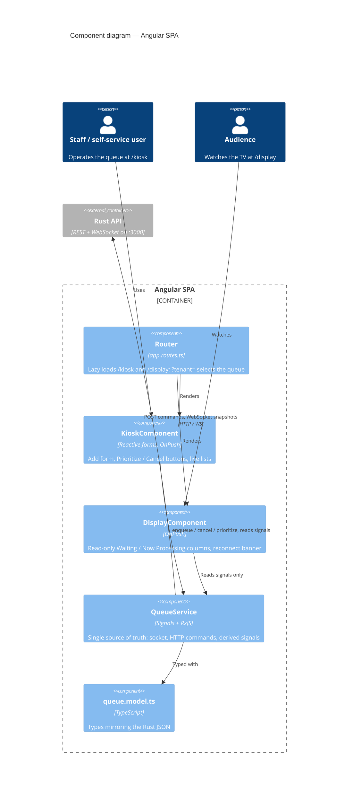
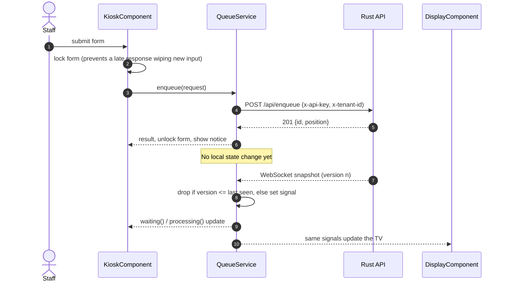
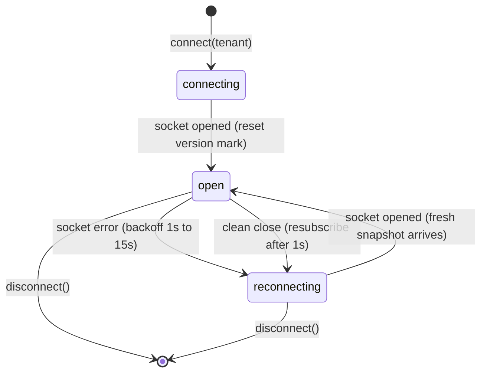

# Queue Engine — Angular UI

Two screens for the Universal Real-Time Queue & Resource Allocation Engine:

| Route | Audience | What it does |
|---|---|---|
| `/kiosk` | Employees / self-service | Reactive form to add items to the queue; **Prioritize** and **Cancel** buttons for waiting items; live view of what is waiting and processing. |
| `/display` | Wall-mounted TV | Read-only, auto-updating **Waiting** / **Now Processing** columns plus a "recently completed" strip. Shows a *Reconnecting…* banner if the connection drops. |

Both accept `?tenant=<id>` (e.g. `/display?tenant=acme`) to show a specific tenant's queue. Default tenant: `default`.

The UI talks to the Rust backend in [`../Backend`](../Backend/README.md). The endpoints it consumes are documented in [`API_CONTEXT.md`](API_CONTEXT.md).

## Quick start

Prerequisites: Node 20+ (tested on 24) and the backend running on `localhost:3000`.

```bash
npm install
npm start                 # http://localhost:4200  (redirects to /kiosk)
```

Start the backend first (from `../Backend`): `API_KEYS=kiosk-key-123 cargo run`. The kiosk ships with the key `kiosk-key-123`; if the backend has no `API_KEYS` it runs open (dev mode) and any key works.

## How it works

### C4 level 3 — components of the Angular SPA



### Data flow: commands go out over HTTP, state comes back over WebSocket



### Connection state



- **One source of truth:** [`QueueService`](src/app/queue/queue.service.ts) owns a single persistent RxJS `webSocket`. Every message is a *full snapshot*, stored in a private writable signal and exposed as read-only signals (`snapshot`, `waiting`, `processing`, `completed`, `status`).
- **Commands never touch local state.** `enqueue`, `cancel` and `prioritize` are plain HTTP calls; the UI changes only when the server's next snapshot arrives. All screens therefore always show what the server actually holds.
- **Stale-proofing:** snapshots carry a monotonic `version`; older or duplicate ones are dropped. The high-water mark resets on every (re)connect because a restarted server starts again at version 0.
- **Resilience:** exponential backoff (1s → 15s) on socket errors, and an automatic 1s resubscribe on a clean server close. `status` is `connecting | open | reconnecting`.
- **Rendering:** standalone components, `OnPush`, new control flow (`@for` tracked by `item.id`). No manual subscriptions in components.

### Project layout

```
src/app/
  queue/
    queue.model.ts        TypeScript mirror of the Rust JSON (discriminated union on `status`)
    queue.service.ts      WebSocket + HTTP + signals
    queue.testing.ts      FakeSocket and snapshot builders for unit tests
  kiosk/                  KioskComponent (.ts/.html/.spec.ts)
  display/                DisplayComponent (.ts/.html/.spec.ts)
  app.routes.ts           /kiosk, /display (lazy loaded)
e2e/
  mocked/                 Playwright tests against an in-test fake backend
  integration/            Playwright tests against the real Rust backend
  support/                mock-backend.ts, page objects
```

## Configuration

Currently constants at the top of [`queue.service.ts`](src/app/queue/queue.service.ts):

| Constant | Default | Meaning |
|---|---|---|
| `API_BASE` | `http://localhost:3000` | REST base URL |
| `WS_BASE` | `ws://localhost:3000` | WebSocket base URL |
| `KIOSK_API_KEY` | `kiosk-key-123` | Sent as `x-api-key`; must be in the backend's `API_KEYS` |

Move these to Angular environment files per deployment. The key is visible in the browser bundle, so use a low-privilege key for kiosks and keep privileged keys for server-to-server callers.

## Testing

```bash
npm run test:unit          # Vitest via ng test — services and components, no network
npm run e2e                # Playwright, mocked backend (starts ng serve itself)
npm run e2e:integration    # Playwright, REAL Rust backend (starts `cargo run` and ng serve itself)
```

First time only: `npx playwright install chromium`.

| Suite | Tests | What it proves |
|---|---|---|
| Unit | 24 | Snapshot handling (stale/duplicate/restart), reconnect on error and clean close, request headers and bodies, form validation, rendering of both screens. |
| E2E mocked | 12 | Real browser flows (enqueue, validation, error display, prioritize, cancel, live updates, reconnect banner, kiosk ↔ display sync) against a fake server that mimics the real wire protocol. Fast and deterministic. |
| E2E integration | 10 | The same UI against the real backend: live enqueue→process→complete, worker overflow, prioritize/cancel, tenant isolation, webhook-style headless POST, auth and validation errors. |

`playwright.integration.config.ts` reuses a backend already listening on `:3000`, or starts one with `API_KEYS=kiosk-key-123` (first run compiles it, so allow a few minutes). Each test uses its own tenant so tests are isolated and parallel-safe.

## Build

```bash
npm run build              # production bundle in dist/queue-ui
```

Serve `dist/queue-ui/browser` from any static host; the SPA needs a fallback to `index.html` for `/kiosk` and `/display`.
