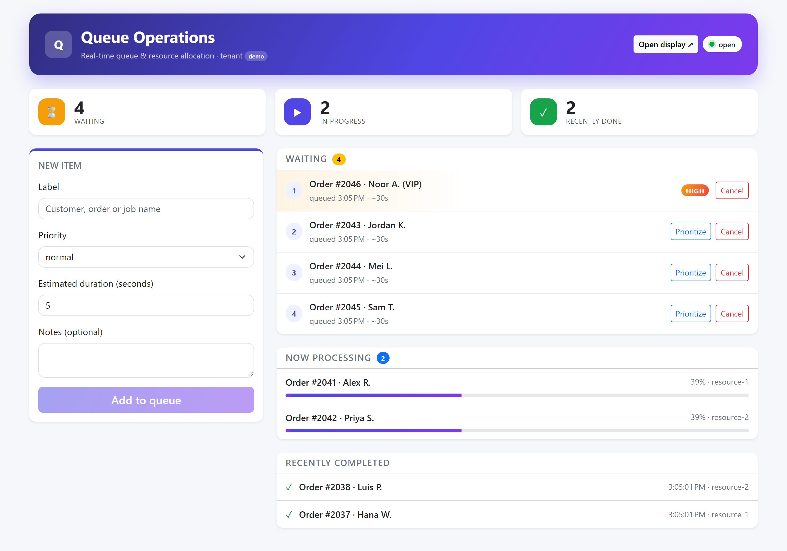
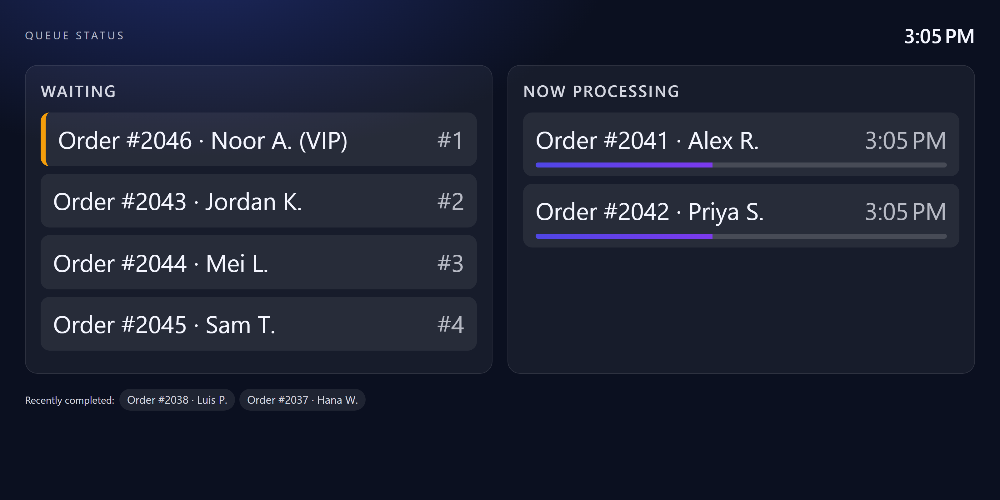
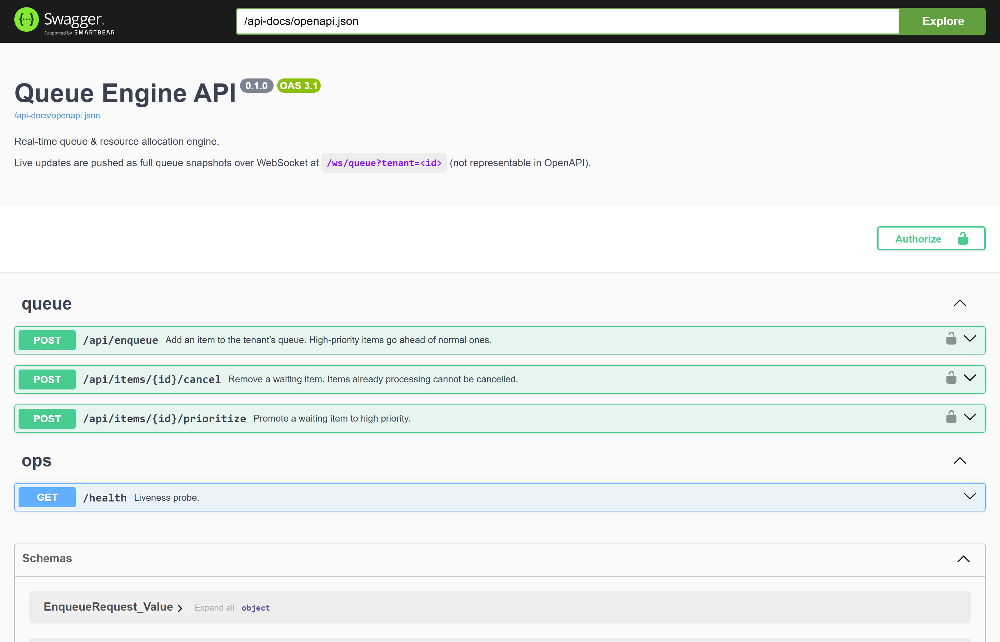
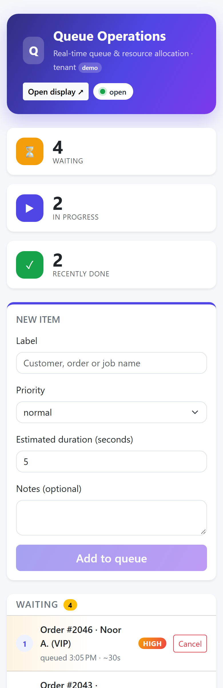
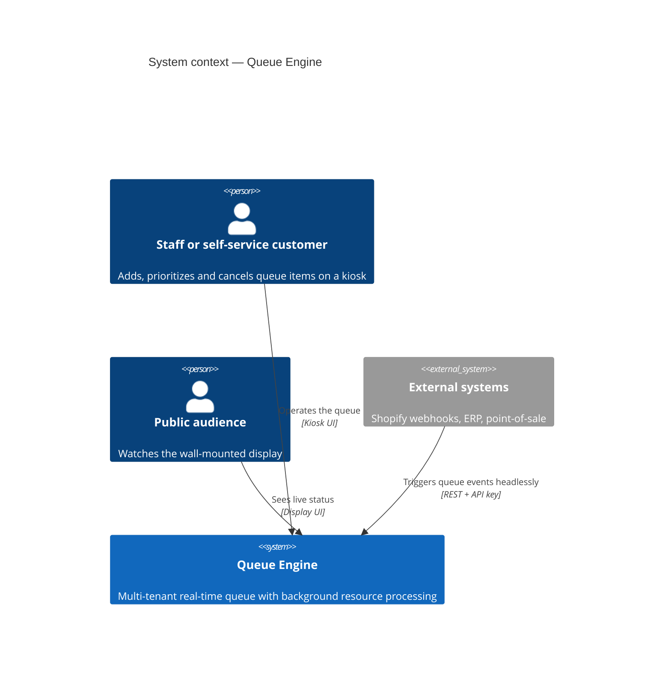
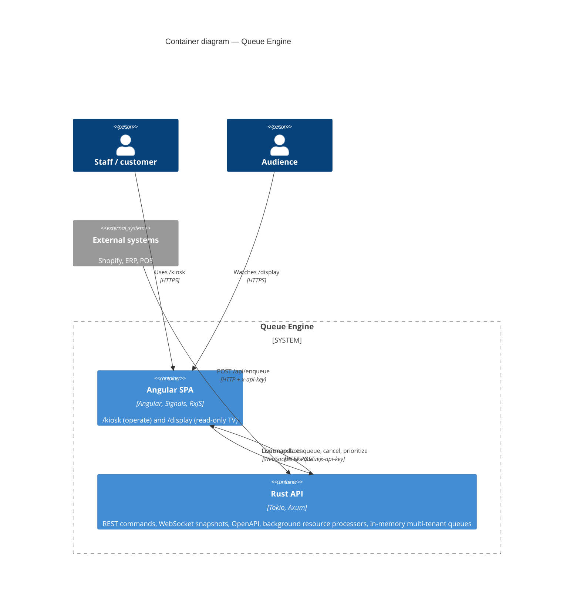
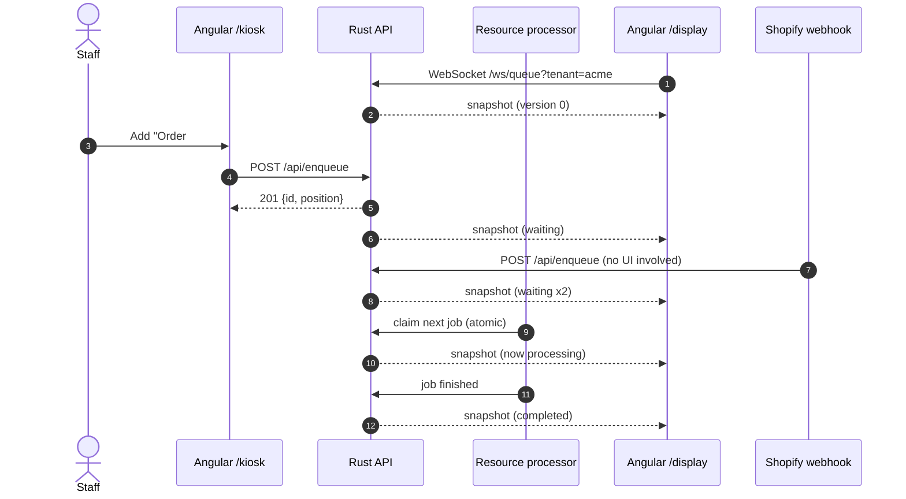
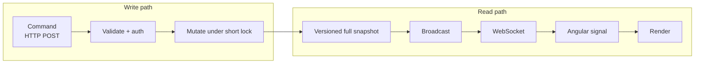

# Universal Real-Time Queue & Resource Allocation Engine

A white-label B2B queue engine. Customers check in, orders get fulfilled, factory jobs get processed: the same engine serves all of them because the item payload is opaque to the core.

## Overview

**What we are building.** A proof of concept for a real-time queue that everyone can *see*. Staff add and reorder items on a kiosk, background workers process them, and a wall-mounted display shows the live state, all driven by one Rust server that owns the truth. Web shops, ERPs and point-of-sale systems can feed the same queue through a documented REST API.

**Why.** Queue state usually lives in someone's head, a spreadsheet or a paper ticket. One source of truth, pushed live to every screen, removes the "where am I in line?" question.

| | |
|---|---|
| **Kiosk** (`/kiosk`) | Add items, set priority and duration, prioritize or cancel waiting ones, watch progress live |
| **Display** (`/display`) | Read-only TV board: waiting, now processing with progress, recently completed |
| **REST API + Swagger** | `POST /api/enqueue`, `/api/items/{id}/cancel`, `/api/items/{id}/prioritize`, documented at `/swagger-ui` |
| **Live updates** | WebSocket pushes a versioned snapshot on every change, so no screen ever shows stale data |
| **Multi-tenant** | `?tenant=<id>` gives each business its own isolated queue |

### Screenshots

**Kiosk**: operate the queue



**Display**: the wall-mounted TV board



**API docs**: Swagger UI served by the backend



<details>
<summary>Mobile layout</summary>



</details>

*Screenshots show the `demo` tenant with sample data (`?tenant=demo`).*

### Project status

Proof of concept. Backend: 31 tests. Frontend: 24 unit and 22 browser tests. Known hardening work (tenant-scoped keys, authenticated WebSocket, request limits, no key in the browser bundle) is tracked in [`security.md`](security.md) and must be done before any real deployment. The story behind the design is in [`article.md`](article.md).

| Part | Stack | Docs |
|---|---|---|
| [`Backend/`](Backend/README.md) | Rust, Tokio, Axum, WebSocket, OpenAPI | API, component diagram, concurrency design, tests |
| [`Frontend/`](Frontend/README.md) | Angular (signals, RxJS), Vitest, Playwright | Screens, component diagram, state management, tests |

## Architecture

### C4 level 1 — system context



### C4 level 2 — containers



Level 3 (components) is in each sub-project: [Rust API](Backend/README.md#architecture) and [Angular SPA](Frontend/README.md#how-it-works).

### End-to-end flow



### Design principles



- **The UI never mutates its own state.** Commands go over HTTP; the result arrives as the next snapshot, so every screen shows what the server holds.
- **Snapshots, not deltas.** They are idempotent, versioned per tenant, and repair any missed message.
- **Short locks, unlocked work.** The server lock is never held across an `.await` or while a job runs.

## Run everything

Terminal 1, backend (needs Rust, plus the MSVC Build Tools on Windows):

```powershell
cd Backend
$env:API_KEYS = "kiosk-key-123"
cargo run
```

Terminal 2, UI:

```powershell
cd Frontend
npm install
npm start
```

Then open:

- **Kiosk** (operate the queue): http://localhost:4200/kiosk
- **Display** (TV): http://localhost:4200/display. Open it on a second screen or tab and add items in the kiosk.
- **API docs**: http://localhost:3000/swagger-ui

Add `?tenant=<id>` to either page to work with a separate queue.

## Test everything

```powershell
cd Backend;  cargo test                  # 31 tests
cd Frontend; npm run test:unit           # 24 tests
cd Frontend; npm run e2e                 # 12 browser tests, mocked backend
cd Frontend; npm run e2e:integration     # 10 browser tests, real Rust backend
```
